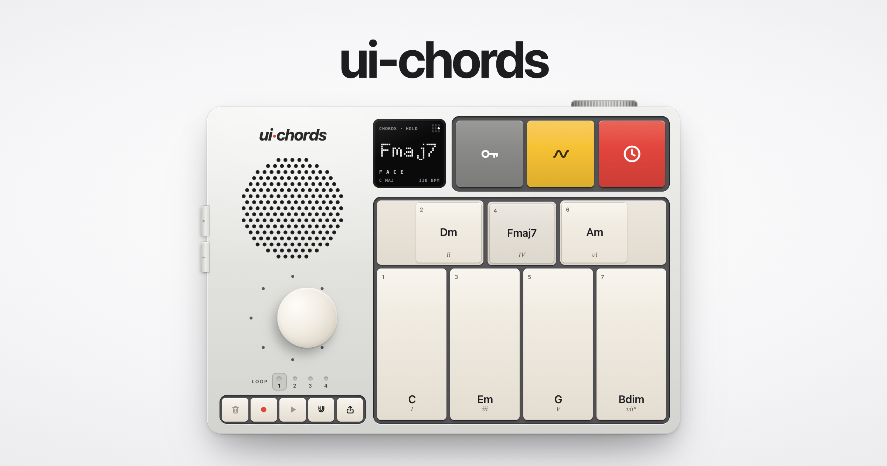

# ui-chords



A pocket chord instrument for the web. Seven keys play the seven chords of any key, a joystick colors them, and a small looper stacks takes of chords, melody and drums that you can export as an MP3 or a video.

Play it at **[ui-chords.dev](https://ui-chords.dev)**.

Inspired by [HiChord](https://hichord.shop/), a hardware pocket chord synth. If you enjoy this, go get the real thing. Made with [ui-sdk](https://ui-sdk.dev/) by nays – Paisanos.

## What it does

- **Seven chord keys.** Each key plays a chord of the chosen key and scale: major, minor, harmonic minor, melodic minor, dorian, mixolydian or lydian. Voice leading keeps the changes smooth, and the screen shows the chord as you play.
- **A joystick that colors the chord.** Hold a key and push the joystick: up swaps major and minor, and the other seven directions add a 7th, dominant 7th, 9th, sus4, 6 or sus2, diminished or augmented. An extended set swaps in add9, add11, m11, 7♯9, 7sus4 and m7♭5.
- **Three parts.** Chords, melody (the keys play single notes of the scale) and drums (kick, clap, snare, hat, tom, rim and open hat, in two kits).
- **Sound.** Eight instruments (FM piano, saw, organ, strings, square, sine, bell, pad), envelopes, a filter, reverb, delay and chorus. Chords can be held, strummed or arpeggiated at the current tempo.
- **A four-track looper.** Pick a loop light and record. There's a four-beat count-in, a metronome shared by every loop, and a beat guide on the screen. Each take can be 2, 4 or 8 bars. Adjust snaps a take to the beat in 1/4, 1/8 or 1/16, and each loop can be muted, recorded over or deleted, with undo.
- **Download.** Save the loops as an MP3, rendered offline so it's sample-accurate, or record a video of the tab while it plays. The video is an H.264 MP4 at up to 1080p and 30 fps, ready for X, Instagram or QuickTime, and you watch it before you download it.
- **Remembers you.** Key, sound, tempo and every other setting are saved in the browser, so a reload picks up where you left off.
- **Anywhere.** Mouse, touch and keyboard. On phones it plays in landscape and scales to fit the screen.

## How to play

| Keys | What they do |
| --- | --- |
| <kbd>1</kbd> – <kbd>7</kbd> | Hold to play a chord |
| <kbd>←</kbd> <kbd>↑</kbd> <kbd>→</kbd> <kbd>↓</kbd> or <kbd>W</kbd> <kbd>A</kbd> <kbd>S</kbd> <kbd>D</kbd> | Color the chord, like the joystick |
| <kbd>Z</kbd> <kbd>X</kbd> <kbd>C</kbd> | Chords, melody, drums |
| <kbd>R</kbd> | Record the selected loop |
| <kbd>Space</kbd> | Play or stop the loop |
| <kbd>⌘</kbd> <kbd>Z</kbd> | Undo |

On touch screens, hold a key, drag the joystick, and tap a loop light, then ● to record.

## Built with ui-sdk

Every control is a [ui-sdk](https://ui-sdk.dev/) component, so focus, keyboard, ARIA and touch behave the same everywhere, and an AI agent can find and use every control through `createAgent`.

| Part of the instrument | ui-sdk |
| --- | --- |
| Chord keys, octave buttons, delete | `Button` |
| Record, play, Adjust, track mute | `Toggle` |
| Loop lights; chords, melody and drums | `SegmentedControl` |
| Tonality, Sound and Rhythm panels | `Popover`, `Field`, `Select`, `SegmentedControl`, `Slider`, `Switch` |
| Download menu | `Menu` |
| Video preview before downloading | `AlertDialog`, `createConfirm` |
| Saved settings | `createLocalStorage` |
| Volume wheel | `Slider` and `bindDrag` |
| Joystick | A custom component built on `definePrimitive` and `createParts` |
| Keyboard shortcuts and the ⌘Z hint | `useShortcut`, `useShortcutHint` |
| Keyboard or pointer focus | `isFocusFromKeyboard` |
| Screen reader notices | `announce` |
| How to use | `Collapsible` |

Some parts are outside ui-sdk because they aren't interface: the synth, drums and looper run on the Web Audio API with an AudioWorklet, the MP3 is encoded with [lamejs](https://www.npmjs.com/package/@breezystack/lamejs), and the video is captured with `getDisplayMedia` and encoded with [Mediabunny](https://mediabunny.dev/) over WebCodecs. Holding a number key sustains a chord until it's released, which needs key-up events, so those keys have their own listener.

## Run it

```bash
npm install
npm run dev     # http://localhost:3000
npm test        # Vitest
npm run lint
npm run build
```

Built with Next.js 16, React 19 and Tailwind CSS 4.
